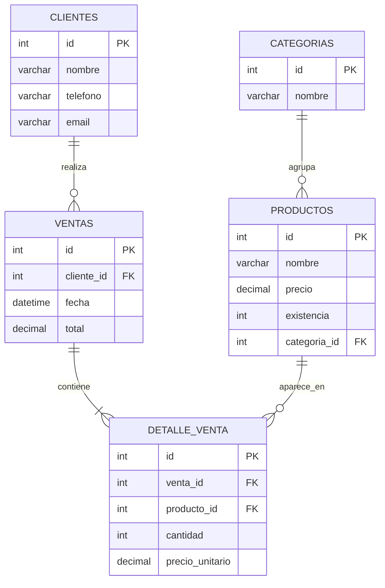

# 🛒 Sistema de Inventario y Ventas

Sistema full stack para administrar el inventario y las ventas de una tienda: productos, categorías, clientes y tickets de venta con control automático de existencias.

> 🚧 **Proyecto en desarrollo.** Actualmente está lista la base de datos. Próximamente: API REST con Spring Boot y frontend con Angular.

## 🧰 Tecnologías

| Capa | Tecnología | Estado |
|---|---|---|
| Base de datos | MySQL 8 | ✅ Lista |
| Backend | Java 21 · Spring Boot · Spring Data JPA | 🔜 En camino |
| Frontend | Angular · TypeScript | 🔜 En camino |

## 🗂️ Modelo de datos



## ✨ Características

- Base de datos normalizada con llaves primarias y foráneas.
- Ventas tipo **ticket**: cada venta puede tener varios productos (relación muchos a muchos con `detalle_venta`).
- **Trigger** `restar_inventario`: descuenta las existencias automáticamente al registrar una venta.
- Se guarda el precio al momento de la venta, para conservar el historial aunque el precio cambie después.
- Datos de prueba incluidos.

## 🚀 Cómo ejecutarlo

1. Clona el repositorio:
   ```bash
   git clone https://github.com/LuiSoto-hub/sistema-inventario-ventas.git
   ```
2. Abre `database/schema.sql` en MySQL Workbench.
3. Ejecuta el script completo. Se crean la base de datos, las tablas, el trigger y los datos de prueba.

> ⚠️ El script empieza con `DROP DATABASE IF EXISTS`, así que borra una base anterior con el mismo nombre.

## 🗺️ Próximos pasos

- [x] Diseño y creación de la base de datos
- [x] Trigger de inventario
- [ ] Validar que no se venda sin existencias
- [ ] API REST con Spring Boot y JPA
- [ ] Cálculo del total del ticket en el backend
- [ ] Frontend con Angular

## 👨‍💻 Autor

**José Luis Soto Chávez** · Desarrollador Full Stack Jr.
📧 sotochavezjoseluis10@gmail.com · GitHub: [@LuiSoto-hub](https://github.com/LuiSoto-hub)